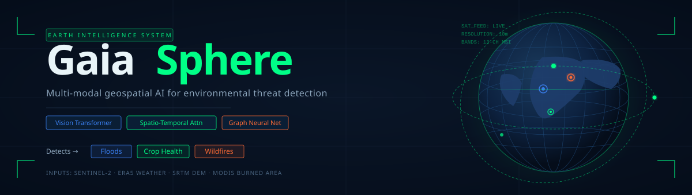

<div align="center">



# 🌍 GaiaSphere

### *Earth Intelligence Through Deep Learning*

**Multi-modal geospatial AI for real-time environmental threat detection**

[](https://python.org)
[](https://pytorch.org)
[](LICENSE)
[]()
[](CONTRIBUTING.md)

<br/>

*Inspired by research at NASA Jet Propulsion Laboratory, Google DeepMind, and ESA's Φ-lab*

</div>

---

## 🛰️ What is GaiaSphere?

GaiaSphere is a research-grade deep learning framework that fuses **satellite imagery**, **meteorological time-series**, and **terrain topology** to detect and predict three critical environmental threats — **floods**, **crop stress**, and **wildfires** — at regional scale.

It mirrors the architecture philosophy behind systems like [Google's FloodHub](https://sites.research.google/floods/), [NASA FIRMS](https://firms.modaps.eosdis.nasa.gov/), and ESA's Copernicus Emergency Management Service: treat the Earth's surface as a dynamic graph, encode it across space and time, and reason over it with learned representations.

```
Satellite Images ──┐
Weather Data    ──►│  GaiaSphere Core  ──► Flood Risk Map
Terrain (DEM)   ──┘  (Multi-modal AI)  ──► Crop Health Index
                                        ──► Wildfire Spread Model
```

---

## 🧠 Architecture

GaiaSphere is built on three composable model families:

### 1. 🔭 Vision Transformer (ViT-Geo)
A patch-based transformer adapted for multi-spectral satellite inputs. Unlike standard ViT, it ingests **13-band Sentinel-2 imagery** (RGB + NIR + SWIR + ...) and uses **positional encodings grounded in geographic coordinates** (lat/lon), not just pixel position.

```
Input: [B, T, C, H, W]  →  Patch Embed  →  Geo-PE  →  Transformer Blocks  →  Spatial Feature Map
       (Batch, Time, 13-channels, 256, 256)
```

### 2. ⏱️ Spatio-Temporal Transformer (ST-Former)
Processes sequences of feature maps across time (e.g., 30 days of daily satellite passes). Uses **factorized attention** — spatial heads attend within each frame, temporal heads attend across frames — making it computationally tractable at regional scale.

```
Spatial Attn:   Each pixel attends to its neighbors within a frame
Temporal Attn:  Each pixel attends to itself across T timesteps
Output:         Fused representation encoding "what changed, where, when"
```

### 3. 🕸️ Graph Neural Network (GeoGraph)
Constructs a **dynamic geographic graph** where nodes are watershed units, crop parcels, or fire risk zones, and edges encode physical connectivity (drainage networks, wind corridors, soil moisture gradients). GNN message passing propagates threat signals spatially.

```
Nodes: Geographic units (watersheds / parcels / grid cells)
Edges: Physical connectivity (flow, wind, adjacency)
GNN:   3-layer GraphSAGE with attention-weighted aggregation
```

### Full Pipeline

```
┌──────────────────────────────────────────────────────────────┐
│                        GaiaSphere                            │
│                                                              │
│  [Sentinel-2]──►[ViT-Geo]──────────────────┐                │
│                                             ▼                │
│  [ERA5/NOAA] ──►[MLP Encoder]──►[ST-Former]──►[GeoGraph]──►[Head]│
│                                             ▲                │
│  [SRTM DEM]  ──►[CNN Encoder]──────────────┘                │
│                                                              │
│  Heads:  FloodNet │ CropHealthNet │ WildfireNet              │
└──────────────────────────────────────────────────────────────┘
```

---

## 📂 Repository Structure

```
GaiaSphere/
│
├── 📁 src/
│   ├── 📁 models/
│   │   ├── vit_geo.py            # Vision Transformer (geo-aware)
│   │   ├── st_former.py          # Spatio-Temporal Transformer
│   │   ├── geo_graph.py          # Graph Neural Network
│   │   └── gaianet.py            # Full multi-modal fusion model
│   │
│   ├── 📁 data/
│   │   ├── sentinel_loader.py    # Sentinel-2 data pipeline
│   │   ├── era5_loader.py        # ERA5 weather reanalysis loader
│   │   ├── dem_loader.py         # Digital Elevation Model loader
│   │   └── dataset.py            # Unified multi-modal dataset
│   │
│   └── 📁 utils/
│       ├── geo_utils.py          # Coordinate transforms, tiling
│       ├── metrics.py            # IoU, F1, NDVI correlation
│       └── visualization.py      # Threat map rendering
│
├── 📁 configs/
│   ├── flood.yaml                # FloodNet hyperparameters
│   ├── crop.yaml                 # CropHealth hyperparameters
│   └── wildfire.yaml             # WildfireNet hyperparameters
│
├── 📁 notebooks/
│   ├── 01_data_exploration.ipynb
│   ├── 02_model_training.ipynb
│   └── 03_inference_demo.ipynb
│
├── 📁 docs/
│   ├── architecture.md
│   ├── datasets.md
│   └── results.md
│
├── train.py                      # Training entry point
├── infer.py                      # Inference entry point
├── requirements.txt
└── README.md
```

---

## 🚀 Quickstart

### Installation

```bash
git clone https://github.com/YOUR_USERNAME/GaiaSphere.git
cd GaiaSphere
pip install -r requirements.txt
```

### Download Sample Data

```bash
python src/data/sentinel_loader.py --region kerala_india --dates 2023-08-01 2023-09-01
python src/data/era5_loader.py --region kerala_india --dates 2023-08-01 2023-09-01
```

### Train a Model

```bash
# Train flood detection model
python train.py --config configs/flood.yaml --task flood

# Train crop health model
python train.py --config configs/crop.yaml --task crop

# Train wildfire spread model
python train.py --config configs/wildfire.yaml --task wildfire
```

### Run Inference

```bash
python infer.py \
  --task flood \
  --checkpoint checkpoints/flood_best.pth \
  --region kerala_india \
  --date 2023-08-15 \
  --output outputs/flood_risk_map.png
```

---

## 📊 Datasets

| Dataset | Source | Resolution | Description |
|---------|--------|------------|-------------|
| Sentinel-2 L2A | ESA Copernicus | 10m | 13-band multispectral imagery |
| ERA5 | ECMWF | 31km | Hourly weather reanalysis (1940–present) |
| SRTM DEM | NASA / USGS | 30m | Global digital elevation model |
| Sen1Floods11 | Google Earth Engine | 10m | Flood labels for 11 flood events |
| CropHarvest | Hannah Kerner et al. | 30m | Global crop labels |
| MODIS Burned Area | NASA FIRMS | 500m | Global fire perimeter history |

---

## 🔬 Model Details

### ViT-Geo (Vision Transformer, Geo-Aware)

| Parameter | Value |
|-----------|-------|
| Input channels | 13 (Sentinel-2 bands) |
| Patch size | 16×16 |
| Embed dim | 768 |
| Transformer depth | 12 |
| Heads | 12 |
| Positional encoding | Fourier + Lat/Lon |

### ST-Former (Spatio-Temporal)

| Parameter | Value |
|-----------|-------|
| Temporal window | 30 days |
| Spatial attn heads | 8 |
| Temporal attn heads | 4 |
| Hidden dim | 512 |
| Layers | 6 |

### GeoGraph (Graph Neural Network)

| Parameter | Value |
|-----------|-------|
| Node features | 256 |
| Edge features | 64 (flow, distance, elevation delta) |
| GNN layers | 3 |
| Aggregation | Attention-weighted mean |
| Architecture | GraphSAGE + GAT |

---

## 🌐 Related Work & Inspiration

This project is conceptually aligned with ongoing research at:

- **NASA JPL** — [ARIA Project](https://aria.jpl.nasa.gov/) for disaster response mapping
- **Google Research** — [FloodHub](https://sites.research.google/floods/) hydrological forecasting
- **ESA Φ-lab** — Foundation models for Earth Observation
- **Microsoft AI for Earth** — Planetary Computer and FarmVibes.AI
- **Stanford SNAP** — Geospatial graph neural networks

Key papers that inspired GaiaSphere:

```
[1] Dosovitskiy et al. (2020) - An Image is Worth 16x16 Words: Transformers for Image Recognition at Scale
[2] Wang et al. (2022) - SatMAE: Pre-training Transformers for Temporal and Multi-Spectral Satellite Imagery
[3] Tseng et al. (2023) - Lightweight, Pre-trained Transformers for Remote Sensing Timeseries
[4] Klemmer et al. (2023) - SatCLIP: Global, General-Purpose Location Embeddings with Satellite Imagery
[5] Zhao et al. (2021) - Dynamic Graph Neural Networks for Sequential Recommendation
```

---

## 🗺️ Roadmap

- [x] Core architecture (ViT-Geo, ST-Former, GeoGraph)
- [x] Multi-modal data pipeline
- [x] Flood, Crop, Wildfire task heads
- [ ] Pre-trained weights on global Sentinel-2 corpus
- [ ] Real-time inference API (FastAPI + Docker)
- [ ] Interactive threat map web dashboard
- [ ] Foundation model pre-training (MAE on satellite imagery)
- [ ] Integration with Copernicus DIAS APIs
- [ ] Mobile-friendly alerts system

---

## 🤝 Contributing

Contributions are warmly welcome — especially from those with backgrounds in:
- Remote sensing / Earth observation
- Geospatial ML / GNNs
- Climate science & hydrology
- MLOps / model serving

Please read [CONTRIBUTING.md](CONTRIBUTING.md) before submitting a PR.

---

## 📄 License

MIT License — see [LICENSE](LICENSE) for details.

---

<div align="center">

**Built with curiosity about our planet. Inspired by the work of NASA, ESA, and Google Earth.**

*"The Earth does not belong to us. We belong to the Earth."*

⭐ **Star this repo** if GaiaSphere resonates with you!

</div>
